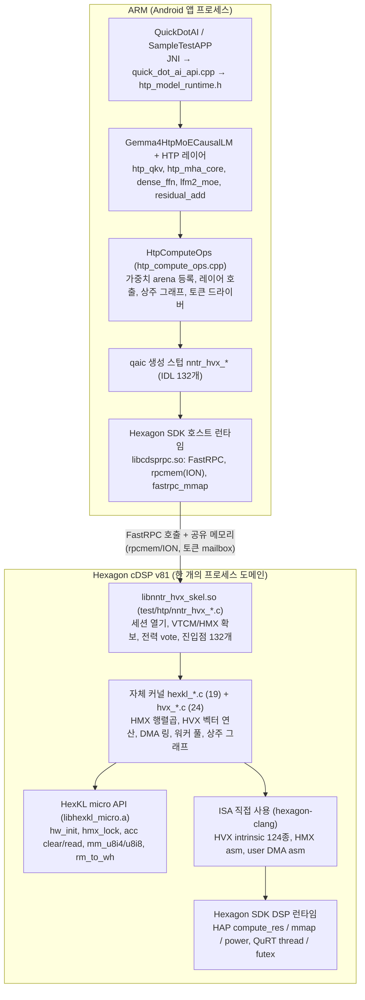

# Gemma4 MoE HTP 경로 커널·API 인벤토리와 Exynos/MTK 요구사항

2026-10-30 · 기준: nntrainer PR #4428 (head a3640d20)

## 한눈에 보기

PR #4428의 Gemma4 26B-A4B MoE는 Qualcomm cDSP(Hexagon v81) 위에서 우리가 직접 작성한 C 커널 라이브러리(`libnntr_hvx_skel.so`)로 돌아갑니다. QNN은 쓰지 않고, HexKL도 "커널 라이브러리"라기보다 HMX 행렬 유닛을 여닫는 micro API 열몇 개만 빌려 쓰는 수준입니다. 나머지는 HVX intrinsic, HMX·DMA 인라인 어셈블리, 그리고 Hexagon SDK 런타임(FastRPC, rpcmem, HAP, QuRT)입니다.

이 문서는 세 가지에 답합니다.

1. **어떤 커널을 쓰는가**: 연산은 전부 자체 커널입니다. `htp_backend/hmx/` 19개, `htp_backend/hvx/` 24개 소스 파일이 HMX 행렬곱, HVX 벡터 연산, DMA 프리페치를 직접 구현합니다. Prefill은 HMX, Decode는 거의 HVX만 씁니다.
2. **어떤 API·SDK에 기대는가**: (1) HexKL micro API, (2) Hexagon SDK 런타임 API(호스트 측 FastRPC·rpcmem, DSP 측 HAP·QuRT), (3) 컴파일러가 열어 주는 HVX/HMX/user-DMA 명령어, (4) qaic·hexagon-clang 툴체인. 섹션 4에 전부 나열했습니다.
3. **Exynos·MTK에 무엇을 요구해야 하는가**: 그래프 컴파일러(ENN, NeuroPilot)가 아니라 "NPU 코어에서 우리 커널을 실행하게 해 주는 저수준 SDK"입니다. 요구 항목 33개를 8개 묶음으로 섹션 5에 정리했습니다.

확인 방법: PR head `a3640d20`을 받아 모델 → 레이어 → `HtpComputeOps` → FastRPC 스텁 → DSP skel → 커널 → SDK 심볼 순으로 호출을 grep/추적했습니다. 문서(`docs/gemma4-htp-*.md`)는 방향 잡는 데만 썼고, 아래 내용은 모두 소스에서 확인한 것입니다.

## 실행 구조: 호출이 어디까지 내려가는가

호출은 ARM 쪽에서 세 겹(앱, 모델·레이어, `HtpComputeOps`)을 지나 FastRPC 한 번으로 DSP에 들어가고, 거기서부터는 전부 우리 코드입니다. 벤더 코드가 끼어드는 지점은 네 곳뿐입니다: 호스트의 FastRPC·rpcmem 런타임, DSP의 HAP·QuRT 런타임, HMX 유닛을 여는 HexKL micro API, 그리고 컴파일러가 열어 주는 HVX/HMX/DMA 명령어.

QNN은 이 경로에 없고, libsdkl.so는 링크만 되고 호출되는 심볼이 없습니다.

읽는 법: 왼쪽 열이 우리 코드, 오른쪽 열이 벤더가 제공하는 것입니다. 가운데 점선이 ARM과 DSP의 경계이고, 이 경계를 넘는 수단은 FastRPC 호출과 공유 메모리 둘뿐입니다.

세 개의 주소 공간을 기억하면 뒤의 표가 쉽게 읽힙니다.

- **호스트 DDR**: 토크나이저, 임베딩(Q4_0, CPU에서 계산), 스테이징 버퍼.
- **rpcmem(ION) 공유 버퍼**: 가중치 arena(64 MiB 청크 여러 개), expert 캐시, KV 캐시, 레이어 사이 활성값, 토큰 mailbox 페이지(uncached). ARM은 `fastrpc_mmap`, DSP는 `HAP_mmap_get`으로 같은 fd를 맵합니다.
- **VTCM**: DSP 로컬 scratch. 커널은 DMA로 타일을 끌어와 HMX/HVX를 돌리고 결과를 다시 내보냅니다. 2bit expert는 VTCM 안에서 int4로 펼칩니다.

## Prefill과 Decode에서 실제로 쓰는 커널

Prefill과 Decode는 완전히 다른 길을 탑니다. Prefill은 레이어마다 FastRPC를 한 번씩 부르고 HMX 행렬 유닛을 씁니다. Decode는 토큰당 한 번, DSP에 상주하는 그래프(542개 op)를 mailbox로 깨우며, 이때는 HMX를 거의 쓰지 않고 HVX로만 계산합니다(M=1에서는 행렬 유닛이 이득이 없고, 병목은 가중치 대역폭이기 때문입니다).

기준 설정은 `res/gemma4/htp_chat/nntr_config.json`입니다: FC는 QS4CX, MoE expert는 QS2CX_WH(2bit), KV는 q8, 임베딩과 lm_head는 Q4_0, attention·attn_proj·dense_ffn·moe engine은 htp, lmhead_engine은 cpu.

**Prefill: 레이어별 호출**

| 레이어 | ARM 쪽 훅 (ComputeOps) | FastRPC entry (nntr_hvx_*) | DSP 커널 | 연산 유닛 |
| --- | --- | --- | --- | --- |
| htp_qkv_layer (QKV + q/k norm) | gemm_q4_0_batch_norm_fp32 | mm_u8i4_layer_norm_ld | hexkl_mm_u8i4_layer_run + hvx_rmsnorm, hvx_quant_u8, hvx_dequant_i32 | HMX u8×i4, user DMA |
| htp_mha_core (attention, int8 KV) | kv_cache_q_register / set_fixed_scales / append, sdpa_q2_kvcache(_f32, _calib) | kv_register_q, kv_set_fixed_scales_q, kv_append_q, attn_q2_step / _fq / _fqc | hexkl_attn_q2 (QKᵀ·PV), hvx_softmax_q (정수 softmax), hexkl_kv_q (K/V 타일 bake) | HMX u8×i8 2-sweep, HVX |
| o-proj + residual_add | gemm_qs4cx_res_add_fp32 | mm_u8i4_layer_res_add(_u16) | hexkl_mm_u8i4_layer_run, post_res epilogue(hvx_rmsnorm_add) | HMX u8×i4 |
| dense_ffn (gate/up/GeGLU/down) | gemm_q4_0_dense_ffn_fp32 | mm_u8i4_moe_layer_norm(_add), E=1 | hexkl_mm_u8i4_moe_layer_run, hvx_dequant_swiglu | HMX u8×i4 |
| lfm2_moe (router + 128 중 8 expert) | router_logits_fp32, gemm_qs4cx_moe_layer_fp32, register/prefetch_qs4cx_wh_expert_files | router_logits_f32 / _u8i8_f32, mm_u8i4_moe_layer_norm(_add), weight_register_u2i4_arena, weight_swap_batch_u2i4_arena | hexkl_mm_u8i4_moe_layer_run: DMA 링으로 expert 타일 적재, hvx_expand_i2i4(2bit→int4 팔레트, vlut32), hvx_router_rows | HMX u8×i4, HVX, user DMA |
| 가중치 등록 (로드 시) | register_qs4cx_weight, alloc_shared | arena_attach, weight_register_u8i4_arena, weight_set_offsets_batch, weight_set_static_quant | HAP_mmap_get로 arena 맵, 필요 시 hexkl_micro_hmx_rm_to_wh_i4 | - |
| lm_head (prefill 마지막 row) | lm_head_q4_0_prepare, lm_head_q4_0_fp32 | q4m1_register / q4m1_attach, lm_head_q4m1_f32, lm_head_wh_f32 | hvx_q4_gemv_f32 | HVX (ieee-fp 빌드) |

**Decode: 상주 그래프의 op별 커널**

시작 시 `graph_init`, `graph_set_param` / `graph_share_param`, `attn_m1_register`, `attn_m1_seed_kvq`, `token_driver_start`(mailbox fd)를 한 번 부릅니다. 그 뒤로는 ARM이 uncached ION mailbox에 position을 쓰고, DSP의 `hexkl_token_main`이 폴링(`pause`, `qurt_timer_sleep`, `qurt_mem_cache_clean`)하다 그래프를 돌리고 argmax id를 되돌려줍니다. FastRPC 호출은 토큰 루프 안에 없습니다.

| graph op | DSP 커널 | 연산 유닛 |
| --- | --- | --- |
| RMSNORM, QK_NORM | hvx_rmsnorm_apply_f32, hvx_qkv_rmsnorm_f32 | HVX |
| ROPE | hvx_rope_f32 | HVX |
| FC (QS4CX_WH, M=1) | hexkl_mm_u8i4_fc_m1_run → hvx_gemm_u8i4_wh_col (HMX와 bit-identical 정수 경로) | HVX + DMA 링 프리페치 |
| ATTN_M1 (int8 KV) | hvx_attn_m1_forward | HVX only (vrmpy) |
| ADD, scalar | hvx_scale_add_rows_f32, hvx_mul_scalar_f32 | HVX |
| ROUTER_TOPK | hvx_router_softmax_topk_owned_f32, hvx_router_topk_wh | HVX |
| MOE (QS2CX_WH, M=1) | hexkl_mm_u8i4_moe_layer_run(M1_GEMV) → hvx_expand_i2i4 + hvx_gemm_u8i4_wh_col, DMA 큐 4개 | HVX + user DMA |
| DENSE_FFN | hexkl_mm_u8i4_moe_layer_run(E=1) + hvx_geglu_f32 | HVX |
| LM_HEAD (Q4_0 tied) | hvx_q4m1_prep + hvx_q4_gemv_f32, hvx_softcap_m1_f32, hvx_argmax_first_f32 | HVX |

여기서 눈여겨볼 점 하나: HMX는 prefill의 행렬곱과 attention에만 등장합니다. Decode 속도를 결정하는 건 벡터 유닛과 DMA가 DDR에서 expert 가중치를 얼마나 빨리 끌어오느냐입니다. 다른 NPU로 가져갈 때 행렬 유닛 스펙보다 벡터 유닛·DMA·로컬 SRAM 제어권이 더 중요한 이유입니다.

## 현재 의존하는 외부 API와 SDK

벤더에서 가져다 쓰는 것은 네 가지 묶음으로 나뉩니다. 검증된 조합은 Hexagon SDK 6.4.0.x(Tools 19.0.04) + HexKL 1.0 beta2 + Hexagon v81(Galaxy S26 Ultra, SM8850)입니다.

**1) HexKL micro API** (`libhexkl_micro.a`, DSP 쪽 정적 링크)

실제 호출하는 함수는 아래가 전부입니다. HMX 유닛을 여고, 누산기를 비우고 읽고, 타일 레이아웃을 바꾸는 일만 합니다.

| 역할 | 함수 |
| --- | --- |
| 초기화·점유 | hexkl_micro_hw_init(vtcm_base, vtcm_size[, hmx_fp16_rate]), hexkl_micro_hmx_lock / unlock, hexkl_micro_hmx_config_size |
| 누산기 설정 | hexkl_micro_hmx_setup_acc_read_int32 / _f16, hexkl_micro_hmx_acc_clear_int32 / _f16 |
| 행렬곱 한 타일 | hexkl_micro_hmx_mm_u8i4, hexkl_micro_hmx_mm_u8i8, hexkl_micro_hmx_mm_f16 |
| 누산기 읽기 | hexkl_micro_hmx_acc_read_int32 / _f16, hexkl_micro_hmx_copy_32b_to_submatrix, hexkl_micro_hmx_copy_submatrix_to_f16 |
| 레이아웃 변환 | hexkl_micro_hmx_rm_to_wh_i4 / _i8 / _f16, hexkl_micro_hmx_rm_to_ah_f16, hexkl_micro_hmx_ah_to_rm_f16 |
| 상수 | HEXKL_HMX_INT8_BLOCK_N_ROW/COL/INNER = 64/32/32, ACTIVATION_ALIGNMENT 2048, WEIGHTS_ALIGNMENT 128, CONFIG_ALIGNMENT 256 |

성능 때문에 래퍼를 우회한 곳도 있습니다. `hexkl_hmx_mm.h`는 HexKL이 내부에서 발행하는 HMX 패킷(`activation.ub = mxmem(act,0x1f):cm; weight.n = mxmem(wt,0x180)`)을 인라인 어셈블리로 직접 냅니다. 호출당 50사이클짜리 래퍼 비용이 attention 커널 HMX 시간의 절반이었기 때문입니다. `libsdkl.so`(HexKL CPU Macro API)는 meson에서 링크만 되고 호출하는 심볼이 없습니다.

**2) Hexagon SDK 런타임 API**

| 위치 | 영역 | 사용 함수 |
| --- | --- | --- |
| ARM, libcdsprpc.so | FastRPC 세션 | remote_session_control(FASTRPC_THREAD_PARAMS 64 KiB, DSPRPC_CONTROL_UNSIGNED_MODULE), remote_handle64_control(DSPRPC_CONTROL_LATENCY: RPC_POLL_QOS 5000 us, 대체 RPC_PM_QOS), qaic 생성 nntr_hvx_open / close(uri "&*dom=cdsp")와 132개 스텁, CDSP_DOMAIN_ID, AEE** 에러코드 |
| ARM, libcdsprpc.so | 공유 메모리 | rpcmem_init / alloc / free / to_fd (RPCMEM_HEAP_ID_SYSTEM, RPCMEM_FLAG_UNCACHED), fastrpc_mmap / munmap(FASTRPC_MAP_FD). dlsym으로 런타임 해석 |
| ARM, libcdsprpc.so | 비동기 큐 (옵션) | dspqueue_create / export / write / read / read_noblock / get_stat / close. weak 심볼, 없으면 mailbox만 사용 |
| ARM, 환경 | skel 로드 | ADSP_LIBRARY_PATH |
| DSP, HAP | 로컬 메모리 | HAP_query_avail_VTCM, HAP_compute_res_attr_init / _set_vtcm_param / _get_vtcm_ptr, HAP_compute_res_acquire / release |
| DSP, HAP | 공유 메모리 | HAP_mmap_get / put, HAP_mmap / munmap, HAP_mem_get_stats |
| DSP, HAP | 전력 | HAP_power_set: apptype COMPUTE_CLIENT_CLASS, DCVS_v2 PERFORMANCE(NOM..TURBO), HMX_v2 |
| DSP, HAP | 계측·로그 | HAP_perf_get_pcycles / _qtimer_count / _time_us, HAP_perf_qtimer_count_to_us, FARF |
| DSP, QuRT | 스레드·동기화 | qurt_thread_attr_*, qurt_thread_create / join / exit / get_id / get_priority, qurt_futex_wait / wake, qurt_timer_sleep |
| DSP, QuRT | 캐시·유닛 | qurt_mem_cache_clean(FLUSH / INVALIDATE), qurt_hvx_get_units |
| DSP, dspqueue | 비동기 큐 (옵션) | dspqueue_import / read / read_noblock / write / close (weak) |
| DSP, libc·compiler-rt | 기본 | malloc / memalign / memcpy, _*hexagon**, __extendhfsf2 / __truncsfhf2, sqrtf, rintf 등 |

이 목록은 `test/htp/build.sh`가 skel의 undefined symbol을 검사할 때 허용하는 목록과 일치합니다. 즉 DSP 이미지가 제공해야 하는 심볼은 정확히 이만큼입니다.

**3) 컴파일러가 열어 주는 ISA**

| 유닛 | 사용 형태 | 핵심 명령 |
| --- | --- | --- |
| HVX (128 B 벡터) | intrinsic 124종, `hvx_hexagon_protos.h` | u8·i8 내적 누산 Q6_Vw_vrmpyacc_VwVubVb / Q6_Vuw_vrmpyacc_VuwVubRub, 바이트·하프 LUT Q6_Vb_vlut32_VbVbI / Q6_Wh_vlut16_*, fp32·qf32·fp16·qf16 산술(Q6_Vsf_*, Q6_Vqf32_*, Q6_Vhf_*), shuffle/deal(Q6_W_vshuff_VVR, Q6_W_vdeal_VVR), predicate(Q6_V_vmux_QVV, Q6_Q_vcmp_*, Q6_Q_vsetq_R), 포화 pack/unpack, Q6_l2fetch_AP, Q6_dccleaninva_A / dcinva_A / dcfetch_A, Q6_R_vextract_VR |
| HMX (행렬) | 인라인 asm, `-mhmx` | mxmem 패킷(activation.ub / weight.n / weight.b), mxclracc |
| user DMA | 인라인 asm | dmstart, dmlink, dmpoll, release(r):at. 2D 디스크립터 struct(desc_type 9, src/dst bypass 비트), 256개 링으로 DDR arena → VTCM 스트리밍 |
| 스칼라 | asm, builtin | pause(#255), __atomic_thread_fence. ARM 쪽은 cntvct_el0로 DSP QTimer와 대조 |

컴파일 플래그: `hexagon-clang -mv81 -mhvx -mhvx-length=128B -mhmx -G0 -O3 -fPIC`. `hvx_q4_gemv_f32.c`, `hvx_hadamard_f32.c`, `nntr_hvx_sf_probe.c` 세 파일만 `-mhvx-ieee-fp`로 따로 컴파일합니다(qf32 lowering이 비트를 바꾸기 때문).

**4) 툴체인과 헤더**

- `qaic`: IDL → ARM 스텁 + DSP skel 생성. `generate_stub.sh`(ARM)과 `test/htp/build.sh`(DSP)가 같은 IDL을 씁니다.
- `hexagon-clang`, `hexagon-readelf`(undefined symbol 검사, ELF 아키텍처 플래그 확인).
- SDK 헤더: remote.h, AEEStdErr.h, rpcmem.h, HAP_compute_res.h, HAP_mem.h, HAP_vtcm_mgr.h, HAP_power.h, HAP_perf.h, HAP_farf.h, qurt.h, qurt_memory.h, dspqueue.h, hexagon_types.h, hvx_hexagon_protos.h, hexagon_protos.h, hmx_hexagon_protos.h.
- 호스트 검증용 stand-in: `test/htp/host/{stub,inproc,hvx_emu,standin}`에 위 헤더의 x86 대체본이 있어 SDK 없이 CI가 돌아갑니다. 포팅 시 바꿔야 할 표면적이 여기에 그대로 드러나 있습니다.

HVX intrinsic 124종의 전체 목록(범주, 호출 수, 사용 파일)은 이 파일 끝의 부록에 있습니다.

## Exynos(SLSI)·MTK NPU에 요구할 API

요구사항의 출발점은 한 문장입니다. 이 경로는 "NPU 코어에서 우리가 쓴 C 커널 라이브러리를 돌리고, 호스트가 RPC와 공유 메모리로 그것을 부른다"는 전제 위에 서 있습니다. 컴파일된 그래프만 실행하는 SDK로는 이 구조를 재현할 수 없으므로, 아래 항목을 하나씩 명시해서 요구해야 합니다. 각 항목 뒤의 괄호는 지금 Qualcomm에서 쓰는 대응물입니다. 중요도는 "필수"가 없으면 이 경로를 옮길 수 없는 것, "권장"은 없으면 성능이나 개발 효율이 떨어지는 것입니다.

**A. 호스트↔NPU RPC** (FastRPC 대응)

| # | 요구 항목 | 중요도 | 지금 쓰는 것 |
| --- | --- | --- | --- |
| 1 | 사용자 공유 라이브러리를 NPU 프로세스 도메인에 로드하고 세션을 여닫는 API. 라이브러리 경로 지정 방법 포함 | 필수 | nntr_hvx_open / close, ADSP_LIBRARY_PATH |
| 2 | IDL 컴파일러 또는 동등한 스텁 생성기. in/out 버퍼 시퀀스 마사링, 진입점 100개 이상 | 필수 | qaic, nntr_hvx.idl |
| 3 | 동기 RPC 호출과 호출당 오버헤드 수치 (현재 수십~수백 µs 가정) | 필수 | FastRPC |
| 4 | 세션 제어: RPC 스레드 스택 크기, 레이턴시/QoS 모드(poll vs interrupt) | 권장 | remote_session_control, DSPRPC_CONTROL_LATENCY |
| 5 | 저지연 비동기 큐: 공유메모리 패킷, 양방향, NPU 쪽 전용 수신 스레드 | 선택 | dspqueue |
| 6 | 통일된 에러코드와 NPU 크래시 진단 코드 | 권장 | AEE_*, 0x8000040x |

**B. 공유 메모리와 주소 매핑**

| # | 요구 항목 | 중요도 | 지금 쓰는 것 |
| --- | --- | --- | --- |
| 7 | DMA 가능한 공유 버퍼 할당/해제와 fd export. **uncached 옵션 필수** (mailbox 폴링용) | 필수 | rpcmem_alloc / free / to_fd, RPCMEM_FLAG_UNCACHED |
| 8 | 버퍼를 NPU 주소공간에 명시적으로 map/unmap. 64 MiB 청크 다수, 프로세스당 매핑 상한 3.8 GiB 이상 | 필수 | fastrpc_mmap, HAP_mmap_get / put |
| 9 | 호출 사이에 NPU 상주 버퍼 유지 (가중치 arena, KV 캐시, 상주 그래프) | 필수 | arena_attach, 세션 상태 |
| 10 | NPU 쪽 캐시 flush/invalidate API와 ARM↔NPU 메모리 순서 보장 수단 | 필수 | qurt_mem_cache_clean, atomic fence |

**C. NPU 로컬 SRAM** (VTCM 대응)

| # | 요구 항목 | 중요도 | 지금 쓰는 것 |
| --- | --- | --- | --- |
| 11 | 로컬 scratch 크기 질의/획득/해제, 포인터와 정렬 공개. 현재 커널은 2048 B 정렬 타일과 수 MB scratch를 가정 | 필수 | HAP_query_avail_VTCM, HAP_compute_res_* |
| 12 | 로컬 SRAM을 DMA의 소스/목적지로 직접 지정 가능 | 필수 | dst_vtcm bypass 비트 |

**D. DMA 엔진**

| # | 요구 항목 | 중요도 | 지금 쓰는 것 |
| --- | --- | --- | --- |
| 13 | 사용자 수준 2D DMA: src/dst stride, row size, nrows, 디스크립터 체이닝(링 256), 완료 폴링, 캐시 bypass, 스레드별 독립 엔진 4개 이상 | 필수 | dmstart / dmlink / dmpoll, hexkl_dma_desc2d |
| 14 | DDR → SRAM 가중치 스트리밍 대역폭 수치 (decode는 weight-bandwidth bound) | 권장 | 측정값 비교용 |

**E. 행렬 연산 유닛** (HMX 대응, micro API 수준으로 노출)

| # | 요구 항목 | 중요도 | 지금 쓰는 것 |
| --- | --- | --- | --- |
| 15 | 타일 행렬곱 u8×i4 → int32, u8×i8 → int32 (현재 블록 64×32×32). fp16×fp16은 선택 | 필수 | hexkl_micro_hmx_mm_u8i4 / u8i8 |
| 16 | 누산기 clear / read-out(int32, fp16) / 설정 API, 또는 ISA와 디스크립터 명세 공개 | 필수 | acc_clear, acc_read, setup_acc_read |
| 17 | row-major ↔ 유닛 고유 타일 레이아웃 변환 함수와 레이아웃 문서. 오프라인 weight 변환기가 같은 레이아웃을 만들어야 함 | 필수 | rm_to_wh_i4 / i8, copy_32b_to_submatrix, htp_wh_layout.h |
| 18 | 유닛 lock/unlock(배타 점유), 초기화 시 SRAM 베이스/크기 반환 | 필수 | hexkl_micro_hw_init, hmx_lock |
| 19 | 단일 호출 비용과 정렬 제약 공개 (HMX: 패킷당 약 9 cycle, act 2048 B / weight 128 B 정렬) | 권장 | hexkl_hmx_mm.h 주석 |

**F. 벡터 연산 유닛** (HVX 대응, C intrinsic 요구)

| # | 요구 항목 | 중요도 | 지금 쓰는 것 |
| --- | --- | --- | --- |
| 20 | 128 B급 SIMD와 C intrinsic 헤더: u8·i8 내적 누산, fp32/fp16 add·mul·max·min, int↔float 변환, **바이트/하프 LUT**(2bit→int4 팔레트 확장에 필수), shuffle/deal/rotate, 벡터 predicate, 포화 pack/unpack, splat, scalar extract | 필수 | Q6_* intrinsic 124종 |
| 21 | 캐시 제어 intrinsic(prefetch, clean/invalidate)과 비정렬 로드/스토어 | 권장 | Q6_l2fetch_AP, Q6_dccleaninva_A, HVX_UVector |
| 22 | 벡터 유닛 개수 질의와 스레드별 유닛 점유 규칙 | 필수 | qurt_hvx_get_units |

**G. NPU 쪽 RTOS / 런타임**

| # | 요구 항목 | 중요도 | 지금 쓰는 것 |
| --- | --- | --- | --- |
| 23 | 스레드 생성/조인/우선순위/스택 지정 (워커 풀 = 벡터 유닛 수) | 필수 | qurt_thread_* |
| 24 | futex류 저비용 동기화와 spin hint | 권장 | qurt_futex_wait / wake, pause |
| 25 | µs sleep, 사이클/타이머 카운터(호스트 타이머와 대조 가능) | 권장 | qurt_timer_sleep, HAP_perf_* |
| 26 | 힙 malloc/memalign (수백 MB급 graph/scratch), 힙 통계 | 필수 | malloc, HAP_mem_get_stats |
| 27 | 전력/클럭 vote API. 호출 사이 power-collapse 방지 | 권장 | HAP_power_set |
| 28 | 로깅과 호스트에서 읽는 방법, 심볼릭 크래시 덤프 | 권장 | FARF, minidump |
| 29 | fp16 변환 등 compiler-rt/libc 제공 범위 명세 | 권장 | __extendhfsf2 등 |

**H. 툴체인 / 개발 환경**

| # | 요구 항목 | 중요도 | 지금 쓰는 것 |
| --- | --- | --- | --- |
| 30 | NPU 코어용 C/C++ 크로스 컴파일러 (벡터·행렬 유닛 코드젠 플래그, IEEE fp 옵션), readelf/objdump | 필수 | hexagon-clang, hexagon-readelf |
| 31 | 호스트 에뮬레이션 또는 시뮬레이터 (현재 x86 stand-in으로 CI 게이트) | 권장 | test/htp/host |
| 32 | 서명 없이 개발용 라이브러리 로드 허용과 프로덕션 서명 절차 | 필수 | unsigned PD |
| 33 | 아키텍처 버전별 ABI/ELF 식별 (v79/v81처럼 세대별 빌드) | 권장 | ELF e_flags |

우선순위를 하나만 고르라면 E보다 F·C·D입니다. Decode는 행렬 유닛 없이 벡터 유닛과 DMA로만 돌고 있고, 그 속도가 사용자 체감 성능입니다. 행렬 유닛은 prefill을 빠르게 할 뿐입니다.

## 전제와 확인이 필요한 부분

- **요구사항의 전제**: 위 목록은 "지금 구조를 그대로 옮긴다"는 가정입니다. 벤더가 커널 SDK 대신 커스텀 op 플러그인 API만 제공한다면, 최소 조건은 다음 네 가지로 줄어듭니다: 커스텀 op 안에서 벡터 유닛과 로컬 SRAM을 쓸 수 있을 것, 가중치와 KV가 호출 사이에 NPU에 상주할 것, 토큰당 한 번의 저지연 실행, int4/int2 weight 포맷 지원.
- **벤더 SDK 현황은 확인 필요**: Samsung ENN SDK와 MediaTek NeuroPilot(Neuron SDK)이 그래프 컴파일 모델이라는 설명은 제 기억에 기대는 것이고 코드에서 확인한 것이 아닙니다. MTK APU의 프로그래머블 VPU/MVPU, Exynos NPU의 벡터 코어에 대한 커널 SDK가 있는지는 요구서를 보내기 전에 벤더 문서로 확인해야 합니다.
- **Hadamard 경로는 기본 off**: `moe_hadamard`가 설정되지 않은 기본 팩에서는 hvx_hadamard_f32 / hexkl_hadamard_f16 커널과 `moe_set_hadamard_signs` entry가 돌지 않습니다. 표에서 빠진 이유입니다.
- **TL2(네이티브 터너리) 경로도 빠짐**: `weights_tl2`, `weight_swap_batch_tl2_*`, hvx_gemv_u8tl2는 TL2CX_WH 팩 전용입니다. 기본 팩은 QS2CX_WH이므로 제외했습니다.
- **CPU 쪽은 따로 다루지 않음**: 임베딩 테이블 조회, lm_head의 CPU 반쪽, KleidiAI/NEON 커널은 ARM에서 돌고 NPU 포팅과 무관합니다.
- **수치는 문서 기준**: 542 op, prefill 567–578 tok/s, decode 10.8–12.3 tok/s(1,028 in / 109 out) 같은 성능 수치는 `docs/gemma4-htp-user-guide.md`의 2026-10-13 측정값이고 이번에 재측하지 않았습니다.

소스 기준: [nntrainer PR #4428](https://github.com/nntrainer/nntrainer/pull/4428), head `a3640d20`. 핵심 파일은 `nntrainer/tensor/htp_backend/`, `test/htp/nntr_hvx.idl`, `test/htp/build.sh`, `Applications/CausalLM/models/gemma4/gemma4_htp_*.cpp`입니다.

---

## 부록: HVX intrinsic 전체 목록 (124종)

PR #4428 head `a3640d20`의 DSP 소스(`nntrainer/tensor/htp_backend/`, `test/htp/*.c`, `test/htp/*.h`) 52개 파일에서 쓰는 HVX intrinsic 124종 전부입니다. 호출 수는 소스 안의 등장 횟수이고, 파일은 많이 쓰는 순으로 최대 3개만 적었습니다. 벤더 요구서의 F 항목(벡터 유닛) 첨부용으로, 상대 NPU의 벡터 ISA에 같은 동작이 있는지 하나씩 대조하는 체크리스트로 쓰면 됩니다.

먼저 볼 것은 상위 네 묶음입니다. 정수 내적(vrmpyacc)은 int8 attention과 int4 GEMM의 심장이고, LUT(vlut32/vlut16)는 2bit expert를 int4로 펼치는 유일한 수단이며, qf32/qf16은 Hexagon 고유 포맷이라 다른 NPU에는 fp32/fp16 동등 연산으로 치화해야 합니다. 나머지(pack/shuffle/predicate)는 어느 SIMD에나 있는 편이지만 128 B 폭과 pair(W) 레지스터 개념이 없으면 재작성 범위가 커집니다.

### 정수 곱셈·내적 (13종)

| intrinsic | 호출 수 | 주요 사용 파일 |
| --- | --- | --- |
| Q6_Vw_vrmpyacc_VwVubVb | 20 | hvx_gemm_u8i4_wh.c |
| Q6_Vuw_vrmpyacc_VuwVubRub | 19 | hexkl_wh_affine.h, hvx_attn_decode_q.c, hvx_softmax_q.c |
| Q6_Vh_vmpy_VhVh_s1_rnd_sat | 10 | hvx_softmax_q.c |
| Q6_Vw_vmpyieacc_VwVwVh | 8 | hexkl_wh_affine.h, hvx_dequant_i32.c |
| Q6_R_sfmpyacc_RR | 7 | hvx_m1_ops_f32.c, nntr_hvx_sf_probe.c |
| Q6_Vw_vmpyie_VwVuh | 6 | hvx_m1_ops_f32.c, hvx_q4_gemv_f32.c |
| Q6_Ww_vmpyacc_WwVhRh | 4 | hvx_attn_m1_f32.c |
| Q6_Vh_vmpyiacc_VhVhVh | 4 | hvx_gemv_u8tl2.c |
| Q6_Wuw_vmpy_VuhVuh | 2 | hvx_softmax_q.c |
| Q6_Vw_vrmpyacc_VwVubRb | 2 | hvx_q4_gemv_f32.c |
| Q6_Vw_vmpyi_VwRub | 2 | hexkl_attn_q2.c |
| Q6_Vh_vmpyi_VhVh | 2 | hvx_gemv_u8tl2.c |
| Q6_Vh_vmpy_VhRh_s1_rnd_sat | 2 | hvx_softmax_q.c |

### fp32 / qf32 산술·변환 (18종)

| intrinsic | 호출 수 | 주요 사용 파일 |
| --- | --- | --- |
| Q6_Vsf_vmpy_VsfVsf | 228 | hexkl_attn_f16.c, hexkl_attn_q.c, hexkl_attn_q2.c |
| Q6_Vsf_vadd_VsfVsf | 107 | hexkl_attn_q.c, hexkl_attn_q2.c, hvx_add_f32.c |
| Q6_Vsf_vsub_VsfVsf | 68 | hexkl_attn_q.c, hexkl_attn_q2.c, hvx_attn_decode_q.c |
| Q6_Vsf_equals_Vw | 68 | hexkl_attn_q.c, hexkl_attn_q2.c, hvx_attn_decode_q.c |
| Q6_Vsf_equals_Vqf32 | 49 | hexkl_attn_f16.c, hexkl_attn_q.c, hexkl_hadamard_f16.h |
| Q6_Vsf_vmax_VsfVsf | 38 | hexkl_attn_q.c, hexkl_attn_q2.c, hexkl_hadamard_f16.h |
| Q6_Vqf32_vmpy_VsfVsf | 35 | hexkl_attn_q.c, hexkl_hadamard_f16.h, hexkl_mm_u8i4_moe.c |
| Q6_Vsf_vmin_VsfVsf | 19 | hexkl_attn_q2.c, hexkl_hadamard_f16.h, hvx_hadamard_f32.c |
| Q6_Wqf32_vmpy_VhfVhf | 18 | hexkl_attn_f16.c, hexkl_attn_q.c, hexkl_hadamard_f16.h |
| Q6_Vqf32_vadd_Vqf32Vqf32 | 16 | hvx_attn_decode_f16.c, hvx_attn_m1_hf.h, hvx_attn_softmax_f16.h |
| Q6_Vqf32_vadd_Vqf32Vsf | 13 | hvx_attn_decode_f16.c, hvx_exp_f32.h, hvx_rmsnorm_rows_f32.c |
| Q6_Vhf_equals_Wqf32 | 11 | hexkl_attn_q.c, hexkl_hadamard_f16.h, hexkl_mm_u8i4_moe.c |
| Q6_Vqf32_vmpy_Vqf32Vqf32 | 7 | hvx_exp_f32.h |
| Q6_Vqf32_vadd_VsfVsf | 7 | hvx_attn_m1_hf.h, hvx_exp_f32.h, hvx_q4_gemv_f32.c |
| Q6_Vw_equals_Vsf | 5 | hexkl_attn_q2.c, hvx_convert.h, hvx_exp_f32.h |
| Q6_Vqf32_vsub_VsfVsf | 3 | hvx_attn_m1_hf.h, hvx_attn_softmax_f16.h |
| Q6_Vqf32_vsub_Vqf32Vqf32 | 2 | hvx_exp_f32.h |
| Q6_Vqf32_equals_Vsf | 1 | hvx_attn_m1_hf.h |

### fp16 / qf16 산술·변환 (11종)

| intrinsic | 호출 수 | 주요 사용 파일 |
| --- | --- | --- |
| Q6_Vhf_vadd_VhfVhf | 23 | hvx_attn_m1_f32.c, hvx_attn_m1_hf.h, hvx_attn_softmax_f16.h |
| Q6_Vhf_equals_Vh | 17 | hvx_attn_m1_f32.c, hvx_attn_softmax_f16.h |
| Q6_Vhf_vmax_VhfVhf | 11 | hvx_attn_decode_f16.c, hvx_attn_m1_f32.c, hvx_attn_softmax_f16.h |
| Q6_Vhf_vsub_VhfVhf | 10 | hvx_attn_decode_f16.c, hvx_attn_m1_f32.c, hvx_attn_softmax_f16.h |
| Q6_Vhf_vmpy_VhfVhf | 8 | hvx_attn_m1_f32.c, hvx_attn_m1_hf.h, hvx_attn_softmax_f16.h |
| Q6_Vqf16_vadd_Vqf16Vhf | 6 | hvx_attn_softmax_f16.h |
| Q6_Vqf16_vmpy_Vqf16Vqf16 | 5 | hvx_attn_softmax_f16.h |
| Q6_Vqf16_vsub_VhfVhf | 3 | hvx_attn_softmax_f16.h, nntr_hvx_attn_f16.c |
| Q6_Vhf_equals_Vqf16 | 3 | hvx_attn_softmax_f16.h, nntr_hvx_attn_f16.c |
| Q6_Vqf16_vmpy_Vqf16Vhf | 1 | hvx_attn_softmax_f16.h |
| Q6_Vh_equals_Vhf | 1 | hvx_attn_softmax_f16.h |

### LUT (팔레트 확장) (5종)

| intrinsic | 호출 수 | 주요 사용 파일 |
| --- | --- | --- |
| Q6_Vb_vlut32_VbVbI | 16 | hvx_expand_i2i4.c, hvx_gemm_u8i4_wh.c, hvx_gemv_u8tl2.c |
| Q6_Wh_vlut16_VbVhR_nomatch | 3 | hvx_gemv_u8tl2.c, nntr_hvx_vlut_probe.c |
| Q6_Wh_vlut16_VbVhI | 3 | hvx_gemv_u8tl2.c, nntr_hvx_vlut_probe.c |
| Q6_Vb_vlut32or_VbVbVbI | 2 | hvx_gemv_u8tl2.c |
| Q6_Wh_vlut16_VbVhR | 1 | hvx_attn_m1_hf.h |

### 정수 add / sub / max / min / shift (25종)

| intrinsic | 호출 수 | 주요 사용 파일 |
| --- | --- | --- |
| Q6_Vh_vadd_VhVh | 75 | hexkl_attn_q2.c, hvx_attn_softmax_f16.h, hvx_gemv_u8tl2.c |
| Q6_Vw_vadd_VwVw | 51 | hexkl_attn_q2.c, hexkl_mm_u8i4_moe.c, hexkl_wh_affine.h |
| Q6_Vh_vsub_VhVh | 35 | hvx_gemv_u8tl2.c, hvx_softmax_q.c |
| Q6_Vw_vasr_VwR | 29 | hexkl_attn_q2.c, hvx_attn_m1_f32.c, hvx_convert.h |
| Q6_Vw_vsub_VwVw | 22 | hexkl_attn_q2.c, hexkl_mm_u8i4_moe.c, hvx_attn_decode_q.c |
| Q6_Vh_vasl_VhR | 19 | hvx_attn_softmax_f16.h, hvx_gemm_u8i4_wh.c, hvx_gemv_u8tl2.c |
| Q6_Vh_vmax_VhVh | 16 | hvx_softmax_q.c |
| Q6_Vh_vasr_VhR | 16 | hvx_gemv_u8tl2.c, hvx_softmax_q.c |
| Q6_Vw_vasl_VwR | 14 | hexkl_attn_q2.c, hexkl_mm_u8i4_moe.c, hvx_attn_decode_q.c |
| Q6_Vh_vsub_VhVh_sat | 14 | hvx_softmax_q.c |
| Q6_Vuh_vlsr_VuhR | 13 | hvx_attn_softmax_f16.h, hvx_expand_i2i4.c, hvx_gemm_u8i4_wh.c |
| Q6_Vw_vmax_VwVw | 12 | hvx_attn_m1_f32.c, hvx_attn_m1_hf.h, hvx_convert.h |
| Q6_Vuw_vlsr_VuwR | 12 | hvx_attn_m1_hf.h, hvx_exp_f32.h, hvx_m1_ops_f32.c |
| Q6_Vb_vadd_VbVb | 11 | hvx_attn_m1_f32.c, hvx_gemv_u8tl2.c |
| Q6_Vw_vmin_VwVw | 4 | hvx_attn_m1_f32.c, hvx_kv_quant.c, hvx_quant_u8.c |
| Q6_Ww_vaddacc_WwVhVh | 2 | hvx_gemv_u8tl2.c |
| Q6_Vw_vaslacc_VwVwR | 2 | hvx_exp_f32.h, hvx_swiglu_det.h |
| Q6_Vuh_vmax_VuhVuh | 2 | nntr_hvx_attn_q.c |
| Q6_Vuh_vasr_VuwVuwR_rnd_sat | 2 | hvx_softmax_q.c |
| Q6_Vh_vmin_VhVh | 2 | hvx_softmax_q.c |
| Q6_Vh_vasr_VhVh | 2 | hvx_softmax_q.c |
| Q6_Vh_vadd_VhVh_sat | 2 | hvx_softmax_q.c |
| Q6_Vuh_vsub_VuhVuh_sat | 1 | hvx_attn_m1_hf.h |
| Q6_Vuh_vmin_VuhVuh | 1 | hvx_attn_m1_hf.h |
| Q6_Vh_vaslacc_VhVhR | 1 | hvx_attn_softmax_f16.h |

### pack / unpack / shuffle / 재배치 (21종)

| intrinsic | 호출 수 | 주요 사용 파일 |
| --- | --- | --- |
| Q6_V_lo_W | 125 | acc_i24_probe.h, hexkl_attn_f16.c, hexkl_attn_q.c |
| Q6_V_hi_W | 115 | acc_i24_probe.h, hexkl_attn_f16.c, hexkl_attn_q.c |
| Q6_V_vror_VR | 62 | hexkl_hadamard_f16.h, hexkl_kv_q.c, hexkl_mm_u8i4_moe.c |
| Q6_W_vshuff_VVR | 48 | acc_i24_probe.h, hexkl_attn_q.c, hexkl_attn_q2.c |
| Q6_W_vcombine_VV | 26 | hexkl_attn_q.c, hexkl_hadamard_f16.h, hexkl_mm_u8i4_moe.c |
| Q6_Vh_vpack_VwVw_sat | 14 | hexkl_attn_q.c, hvx_attn_decode_q.c, hvx_attn_m1_f32.c |
| Q6_Wh_vunpack_Vb | 13 | acc_i24_probe.h, hvx_attn_m1_f32.c, hvx_dequant_i32.c |
| Q6_Vub_vpack_VhVh_sat | 10 | hexkl_attn_q.c, hvx_attn_decode_q.c, hvx_quant_u8.c |
| Q6_W_vdeal_VVR | 7 | hexkl_attn_q2.c, hvx_attn_softmax_f16.h, hvx_softmax_q.c |
| Q6_Ww_vunpack_Vh | 5 | hexkl_attn_q2.c, hvx_q4_gemv_f32.c |
| Q6_Wuw_vunpack_Vuh | 5 | hexkl_attn_q2.c, hvx_attn_m1_f32.c, hvx_attn_m1_hf.h |
| Q6_Vh_vpacke_VwVw | 5 | hexkl_attn_q2.c, hvx_attn_m1_hf.h, hvx_m1_ops_f32.c |
| Q6_Vb_vpacke_VhVh | 5 | hvx_attn_m1_f32.c, hvx_q4_gemv_f32.c, hvx_softmax_q.c |
| Q6_Vuh_vpack_VwVw_sat | 3 | hexkl_attn_q2.c |
| Q6_Vh_vshuffe_VhVh | 3 | hvx_attn_m1_f32.c, hvx_attn_m1_hf.h |
| Q6_Vb_vpacko_VhVh | 3 | hvx_softmax_q.c |
| Q6_Vb_vpack_VhVh_sat | 3 | hvx_kv_quant.c |
| Q6_Wuh_vunpack_Vub | 1 | hvx_gemv_u8tl2.c |
| Q6_Vb_vshuffo_VbVb | 1 | hvx_gemv_u8tl2.c |
| Q6_Vb_vshuffe_VbVb | 1 | hvx_gemv_u8tl2.c |
| Q6_V_vdelta_VV | 1 | hvx_hadamard_f32.c |

### predicate / 선택 / 비트 논리 (17종)

| intrinsic | 호출 수 | 주요 사용 파일 |
| --- | --- | --- |
| Q6_V_vmux_QVV | 88 | hexkl_attn_q.c, hexkl_hadamard_f16.h, hexkl_mm_u8i4_moe.c |
| Q6_Q_vcmp_gt_VwVw | 18 | hexkl_attn_q.c, hvx_attn_decode_q.c, hvx_attn_m1_f32.c |
| Q6_Q_vsetq2_R | 15 | hvx_attn_m1_f32.c, hvx_quant_u8.c, hvx_softmax_blocked_f32.c |
| Q6_Q_vcmp_eq_VwVw | 15 | hvx_attn_decode_q.c, hvx_convert.h, hvx_hadamard_f32.c |
| Q6_Q_vsetq_R | 12 | hexkl_hadamard_f16.h, hexkl_mm_u8i4_moe.c, hvx_gemv_u8tl2.c |
| Q6_Q_vand_VR | 7 | hvx_gemv_u8tl2.c |
| Q6_Q_or_QQ | 6 | hvx_convert.h, hvx_q4_gemv_f32.c, hvx_softmax_q.c |
| Q6_Q_and_QQn | 6 | hvx_attn_m1_f32.c, hvx_convert.h |
| Q6_Q_vcmp_gt_VuhVuh | 5 | hvx_attn_decode_f16.c, hvx_attn_softmax_f16.h, nntr_hvx_attn_f16.c |
| Q6_Q_vcmp_gt_VhVh | 5 | hvx_attn_softmax_f16.h, hvx_softmax_q.c |
| Q6_Q_and_QQ | 5 | hvx_attn_decode_f16.c, hvx_attn_decode_q.c, hvx_attn_softmax_f16.h |
| Q6_Vh_condnac_QVhVh | 4 | hvx_gemv_u8tl2.c |
| Q6_Vh_condacc_QnVhVh | 4 | hvx_gemv_u8tl2.c |
| Q6_Q_vcmp_eq_VhVh | 4 | hvx_attn_decode_f16.c, hvx_attn_softmax_f16.h, hvx_softmax_q.c |
| Q6_V_vandor_VQR | 3 | hvx_gemv_u8tl2.c |
| Q6_Q_not_Q | 3 | hvx_attn_decode_f16.c, hvx_attn_decode_q.c, hvx_attn_softmax_f16.h |
| Q6_Q_vcmp_gt_VsfVsf | 1 | hvx_attn_math_f32.h |

### splat / 상수 / 논리 / 추출 (9종)

| intrinsic | 호출 수 | 주요 사용 파일 |
| --- | --- | --- |
| Q6_V_vsplat_R | 218 | hexkl_acc_i24.h, hexkl_attn_f16.c, hexkl_attn_q.c |
| Q6_Vh_vsplat_R | 181 | hexkl_attn_f16.c, hexkl_attn_q.c, hexkl_attn_q2.c |
| Q6_V_vzero | 167 | hexkl_acc_i24.h, hexkl_attn_f16.c, hexkl_attn_q.c |
| Q6_V_vand_VV | 74 | hvx_attn_m1_f32.c, hvx_attn_m1_hf.h, hvx_attn_math_f32.h |
| Q6_V_vxor_VV | 35 | hexkl_kv_q.c, hvx_attn_m1_f32.c, hvx_attn_math_f32.h |
| Q6_V_vor_VV | 34 | hvx_attn_m1_hf.h, hvx_attn_math_f32.h, hvx_attn_softmax_f16.h |
| Q6_R_vextract_VR | 13 | hexkl_hadamard_f16.h, hvx_attn_m1_f32.c, hvx_attn_softmax_f16.h |
| Q6_Vb_vsplat_R | 6 | hvx_attn_m1_f32.c |
| Q6_V_vnot_V | 1 | hvx_softmax_q.c |

### 캐시 · 메모리 제어 (5종)

| intrinsic | 호출 수 | 주요 사용 파일 |
| --- | --- | --- |
| Q6_l2fetch_AP | 20 | hexkl_hadamard_f16.h, hvx_attn_m1_f32.c, hvx_dequant_i32.c |
| Q6_dccleaninva_A | 4 | hexkl_dma_ring.c, nntr_hvx_dma_probe.c, nntr_hvx_fc_q4.c |
| Q6_vmem_QRIV | 1 | hvx_attn_m1_f32.c |
| Q6_dcinva_A | 1 | hexkl_dma_ring.c |
| Q6_dcfetch_A | 1 | hvx_m1_ops_f32.c |

타입 쪽도 같이 봐야 합니다. 커널은 `HVX_Vector`(1,816회), `HVX_UVector`(비정렬, 405회), `HVX_VectorPair`(126회), `HVX_VectorPred`(64회) 네 타입 위에 쓰여 있어서, 128 B 벡터와 벡터 pair, 비트 predicate 레지스터가 없는 ISA로 옮기면 intrinsic 치환보다 데이터 레이아웃 재설계가 먼저입니다.

추출 명령: `grep -rhoE '\bQ6_[A-Za-z0-9_]+' nntrainer/tensor/htp_backend test/htp/*.c test/htp/*.h | sort | uniq -c`. 앞서 본문에 126종으로 적었던 숫자는 grep 부분 일치 2건이 섞인 것이라 124종으로 바로잡았습니다.
